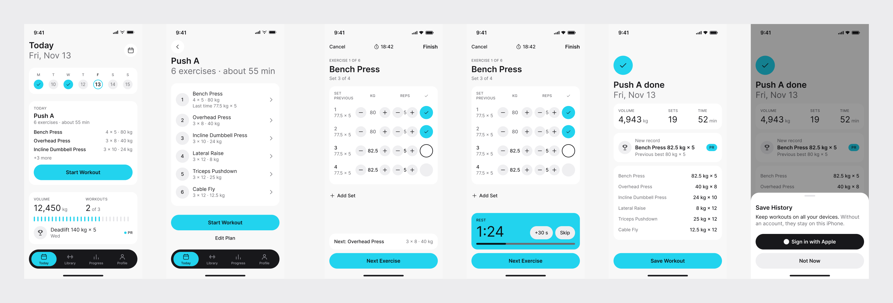
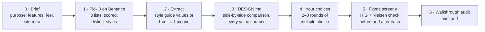
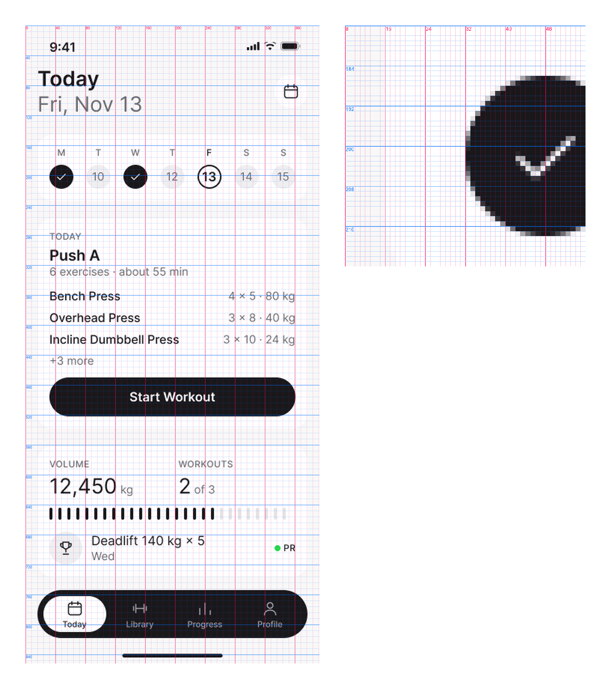
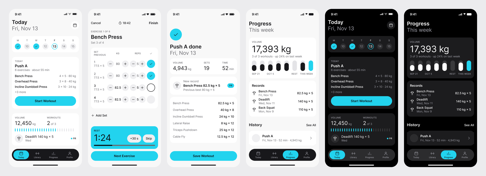
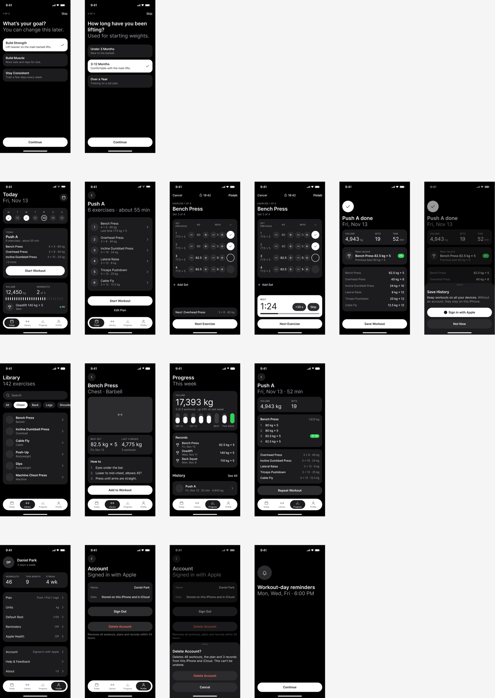

# AutoFigma-AppDesign

English | [简体中文](README.zh-CN.md)

**Design a whole iOS app in Figma from real Behance references, without the "AI look".**

`figma-app-design-builder` is a skill for Claude Code. You describe the app. It picks three well-received Behance case studies with different styles and measures them down to the pixel. It writes a design spec where every number has a source, lets you choose the style through multiple-choice questions, and then draws every screen in Figma. Each screen is checked against Apple's Human Interface Guidelines and Nielsen's 10 usability heuristics.



## Contents

- [Why](#why)
- [How it works](#how-it-works)
- [Features](#features)
- [Installation](#installation)
- [Requirements](#requirements)
- [Usage](#usage)
- [Example: a strength-training app](#example-a-strength-training-app)
- [Repository structure](#repository-structure)
- [Disclaimer](#disclaimer)
- [License](#license)
- [Credits](#credits)

## Why

Ask an AI to "design a fitness app" with no other input and you get the average of its training data: cards inside cards, a border and a shadow on every block, purple-blue gradients, no focal point and filler copy like "Unlock your potential". This skill works from the other direction:

1. **Learn from real work first.** Three popular, stylistically distinct apps of the same kind, measured precisely.
2. **Let the person decide.** Every style decision is a multiple-choice question whose options come from those references.
3. **Design by the rules.** Every screen is drawn only from the agreed spec and checked against Apple HIG and Nielsen's heuristics.

## How it works



| Step | What happens | Output |
|---|---|---|
| **0 · Brief** | Asks who the app is for, the must-have features, the feel you want and the scope. Drafts a site map (every screen, which tab it belongs to, which flows are modal) and confirms it with you. | `00-brief.md` |
| **1 · Pick 3 works on Behance** | Searches Behance and takes about the top 15 from each of **Most Appreciated**, **Most Viewed** and **Most Discussed**. It filters out non-apps and works with too few flat screens, then scores the rest on popularity (appreciations, views, comments, appreciation rate, number of lists). It reviews the top candidates visually and picks 3 whose style tags clearly differ, so the later choices are real choices. | `01-candidates.csv`, `01-candidates.md` |
| **2 · Extraction** | If a work includes a **Design Style Guide** page, its values are used directly (the author's numbers beat measurements). Everything else is measured on a grid where **one cell is one @1x design pixel (1 pt)**: margins, sizes, gaps, radii, colours. UX is recorded too: main flow, navigation, feedback, when sign-in is asked. | `research/<app>.md` |
| **3 · DESIGN.md** | Part 1 compares the 3 works side by side, one row per dimension (layout, type, colour, radius, cards, buttons, Tab Bar…). Every cell is sourced, and practices that break HIG are marked. | `DESIGN.md` Part 1 |
| **4 · Your choices** | 2–3 rounds of 3–5 multiple-choice questions, global choices first (style, screen size, margins), component details later. Each option states exact values and its source; HIG-breaking options are not offered; a sourced recommendation is given. You can answer "recommended" for any or all of them. | `DESIGN.md` Parts 2–3 |
| **5 · Figma screens** | Builds variables, text styles and components, then draws the site map screen by screen using only values from DESIGN.md. Before each screen it lists the HIG and Nielsen rules involved; after drawing it runs the checklists and fixes failures. Screens missing from all 3 references (paywall, empty state…) borrow structure from another Behance work, never its visuals. | Figma file, `screens.md` |
| **6 · Walkthrough audit** | Walks each main task end to end for problems a single screen cannot show (flows too long, no way out, inconsistent wording). Rates them on Nielsen's 0–4 severity scale and runs the HIG and anti-AI-look checklists across the whole app. It is a report: you decide what to change. | `audit.md` |

The skill talks to you and writes its Markdown files in your language. Component names, HIG terms and units stay in English (Tab Bar, Sheet, 44 pt).

## Features

### Every claim has a source

To keep hallucinated numbers out, every value and design judgement, in chat and in every file, carries a tag:

| Tag | Example |
|---|---|
| Behance work | `[Behance · LGrow - Personal Coaching Fitness App · Tobi Bui & Design Team Ekotek · https://www.behance.net/gallery/254678997/… · image 07]` |
| Measured | `[Measured ≈ · research/nutripal/04_zoom_card.png · ±2 pt]` |
| Author's style guide | `[Spec · NutriPal img 16]` |
| Apple HIG / Nielsen | `[HIG · Tab bars]`, `[Nielsen #5 Error prevention]` |
| Your decision | `[User choice · round 1 Q3]` |
| No outside source | `[AI suggestion]`, never presented as fact |

Behance numbers are only written if they were actually read on the page ("not read" otherwise). When references disagree, each value is listed with its own source instead of an average.

### Three helper scripts

All three are plain Python 3 scripts in `skills/figma-app-design-builder/scripts/`. Claude runs them during the workflow; you can also run them yourself.

| Script | What it does | Example |
|---|---|---|
| `rank_candidates.py` | Scores the Behance candidate pool. Round 1 ranks by popularity, using percentiles within the pool so results are reproducible. Round 2 adds the visual review (popularity 40% + visual 60%, +0.05 for a style guide) and picks N works that differ in at least 2 of 5 style tags. | `python scripts/rank_candidates.py design/01-candidates.csv --final 3` |
| `grid_extract.py` | 1 cell = 1 pixel measuring. Scales a screen in a presentation image back to its design width. Then `info` checks sharpness, `overview` draws a labelled grid, `zoom` enlarges a region with a line per cell, `edges` reads margins, sizes and gaps along a row or column, and `colors`/`sample` read colours. Needs Pillow. | `python scripts/grid_extract.py edges shot.png --crop 120,80,520,946 --row 250` |
| `contrast.py` | WCAG contrast ratio with the HIG thresholds (4.5:1 up to 17 pt, 3:1 for 18 pt and up or bold). Used instead of guessing whether grey text is readable. | `python scripts/contrast.py "#6B6B70" "#F8F8F8"` → `4.99:1 … PASS` |



### An anti-AI-look checklist

[`references/anti-ai-checklist.md`](skills/figma-app-design-builder/references/anti-ai-checklist.md) lists common symptoms in four groups, with what well-regarded real designs do instead. It is used as a constraint while designing and as a checklist in review:

- **Visual:** two layers at most (background + card), layering by fill instead of borders and shadows, one accent used only for state and the main action, one pill radius plus one card radius, one icon set, no emoji icons, no glows.
- **Structure:** one hero per screen; spacing inside a group about half the spacing between groups; Sheets instead of centred dialog cards; no placeholder cards for data that does not exist.
- **Copy:** as few words as possible, following Apple's Writing guideline: "Check each word to be sure it needs to be there. If you can use fewer words, do so." No caption that repeats what is already on screen, no "we", few "your". Buttons are verb + object ("Start Workout"), errors say how to fix them, one word per concept.
- **Data:** realistic names and prices; totals that add up; numbers that agree across every screen.

It ends with seven self-check questions, such as "Cover the logo: could you still tell which app this is?"

## Installation

Pick one of the three methods. Restart Claude Code afterwards.

### 1. Claude Code plugin

```
/plugin marketplace add ws0325/AutoFigma-AppDesign
/plugin install figma-app-design-builder@autofigma-appdesign
```

### 2. `npx skills`

```bash
npx skills add ws0325/AutoFigma-AppDesign
```

### 3. One-line installer

macOS / Linux:

```bash
curl -fsSL https://raw.githubusercontent.com/ws0325/AutoFigma-AppDesign/main/install.sh | bash
```

Windows PowerShell:

```powershell
irm https://raw.githubusercontent.com/ws0325/AutoFigma-AppDesign/main/install.ps1 | iex
```

The installer copies the skill to `~/.claude/skills/figma-app-design-builder` (replacing an older copy) and installs Pillow for the grid script. To install into the current project's `./.claude/skills` instead:

```bash
curl -fsSL https://raw.githubusercontent.com/ws0325/AutoFigma-AppDesign/main/install.sh | SKILL_SCOPE=project bash
```

```powershell
$env:SKILL_SCOPE = "project"; irm https://raw.githubusercontent.com/ws0325/AutoFigma-AppDesign/main/install.ps1 | iex
```

From a cloned copy, run `bash install.sh` or `powershell -ExecutionPolicy Bypass -File install.ps1`. To uninstall, delete the `figma-app-design-builder` folder from your skills directory.

## Requirements

| Requirement | Why |
|---|---|
| **Claude Code**, or another client that loads Agent Skills | Runs the skill. |
| **Figma, connected through the Figma MCP server** | Needed to write screens into Figma. Without it, the skill asks you to connect Figma and produces HTML screens (`design/screens.html`) in the meantime. |
| **A browser tool** (for example Claude in Chrome) | Behance pages are rendered with JavaScript; plain web fetching returns HTTP 403. Without a browser, the skill asks you for links or screenshots. |
| **Python 3 + Pillow** | For the scripts. Pillow is only needed by `grid_extract.py` (`pip install pillow`). If pip refuses to install into a system-managed Python, use a virtual environment. |

## Usage

Just describe the app you want. For example:

```
Design me a habit-tracking app.
```
```
帮我做一款记账 App
```
```
I want an iPhone app for booking climbing-gym sessions. Dark mode matters most.
```
```
Find Behance references for a meditation app and write a DESIGN.md, but don't draw any screens yet.
```

What you will be asked, and when:

1. **At the start:** one message of brief questions (purpose, must-have features, the feel you want, scope), then a site map to confirm.
2. **After the research:** a short report of the 3 picks with links and a one-line style for each. No question here; it carries on.
3. **Style decisions:** 2–3 rounds of 3–5 multiple-choice questions. Answer like `1A 2C 3 recommended`, or `recommended for the rest`.
4. **Before drawing:** the final rules and quick-reference table, for you to confirm.
5. **At the end:** the audit report. Nothing is changed until you say so.

All output goes into a `design/` folder in the project of the app being designed (or wherever you say):

```
design/
├── 00-brief.md          Brief and site map
├── 01-candidates.csv    Behance candidate pool (script input)
├── 01-candidates.md     Scores and the 3 picks
├── research/<app>/      Reference screenshots and grid images (local only)
├── research/<app>.md    Full extraction for one work
├── DESIGN.md            The design spec: comparison + your choices + final rules
├── screens.md           Screen list, Figma links, per-screen checks
└── audit.md             Walkthrough audit report
```

If that project is a git repository, add `design/research/*/` to its `.gitignore` so downloaded reference images are never committed.

## Example: a strength-training app

[`examples/fitness-app/design/`](examples/fitness-app/design/) is a complete run for **Repwise**, a demo strength-training log.

**Brief** ([`00-brief.md`](examples/fitness-app/design/00-brief.md)). For people aged 20–35 who go to the gym about three times a week and lose track of what they lifted last time. Top tasks: start today's workout, log sets quickly with a rest timer, see progress. Feel: calm, focused, not neon, not gamified. Sign in with Apple only when the first workout is saved.

**Picks** ([`01-candidates.md`](examples/fitness-app/design/01-candidates.md)). 32 candidates from the search `fitness app`. 5 were excluded by hard filters (one of them only after all 13 of its images were checked: almost every screen was tilted or hand-held). 16 were reviewed image by image. The top 8 by popularity covered only two styles, so ranks 9–16 were reviewed as well.

| | Work | Author | Style |
|---|---|---|---|
| A | [Fitness mobile app \| UX/UI design](https://www.behance.net/gallery/243053067/Fitness-mobile-app-UXUI-design) | Oksana Bashkatova, with ШКОЛА ДИЗАЙНА | Light grey + white cards, lime and lavender accents, photos |
| B | [LGrow - Personal Coaching Fitness App \| UX/UI](https://www.behance.net/gallery/254678997/LGrow-Personal-Coaching-Fitness-App-UXUI) | Tobi Bui & Design Team Ekotek | Black, white primary buttons, blue glow, dot-matrix numbers |
| C | [AI Habit & Fitness Tracker Mobile App \| UI UX Design](https://www.behance.net/gallery/250740123/AI-Habit-Fitness-Tracker-Mobile-App-UI-UX-Design) | Sriraj Mohan | Off-white, monochrome, colour only in charts |

**Extraction** ([`research/`](examples/fitness-app/design/research/)). A and C have full style guides, which were used directly; B's sizes were measured (±1.2 pt). The check flagged practices that were not adopted: grey secondary text at 2.3–2.6:1 contrast (A, C), a Light font weight (C), icon-only tabs (C), sign-in at launch (B) and decorative glows (B).

**A few of the choices** ([`DESIGN.md`](examples/fitness-app/design/DESIGN.md) Part 2):

| Question | Choice | Result |
|---|---|---|
| Overall style | C | Off-white base, monochrome UI, colour only for data |
| Side margins | A | 16 pt (Femotion's style guide, confirmed by measurement in A and C) |
| Background layers | A | `#F8F8F8` base + `#FFFFFF` cards, no shadow |
| Accent | recommended, then changed | First near-black `#18181B`; after review the user asked for something more vivid, so actions and the one data highlight became cyan `#22D3EE` with near-black text on it (white on cyan fails at 1.81:1) |
| Typeface | recommended | Inter (C's Lufga is a paid font) |
| Card radius | recommended | 20 (measured on C) |

The user answered "just do a version" after round 1, so rounds 2–3 used the recommended options. Each of those rules is tagged and listed in the decision record so it can be revisited. Secondary text uses `#6B6B70`, which passes at 4.99:1 on the base colour (checked with `contrast.py`), instead of the references' failing greys.

**Screens** ([`screens.md`](examples/fitness-app/design/screens.md), [Figma file](https://www.figma.com/design/4OA6e0F7zsToQrgMqzkW6Z)). 18 high-fidelity screens: onboarding, Today, the whole workout flow (preview, logging, rest timer, summary, sign-in sheet), library, progress, profile, account deletion, the reminders permission screen, and the rest timer as a Lock Screen Live Activity and in the Dynamic Island. After the variables, text styles and components were built, four subagents drew the flows in parallel from one shared brief, so every screen uses the same sample data. Every app screen also has a Dark copy, made by switching the variable mode.



**Audit** ([`audit.md`](examples/fitness-app/design/audit.md)). Four tasks were walked end to end. Eight problems were fixed, including: wordy copy trimmed under HIG's "use fewer words" rule; a duplicate "Done" next to "Save Workout"; a back button on the permission screen; a component fill that turned white in Dark mode; and a Dark tab label at 3.26:1 raised to 5.30:1. Eight smaller items are listed as open (for example the official Sign in with Apple asset and exercise images).



The full spec, with type scale, colour tokens for light and dark, components, page patterns, Nielsen practices per heuristic and the per-screen checklist, is in [`examples/fitness-app/design/DESIGN.md`](examples/fitness-app/design/DESIGN.md).

## Repository structure

```
AutoFigma-AppDesign/
├── .claude-plugin/
│   ├── plugin.json               Plugin manifest (figma-app-design-builder)
│   └── marketplace.json          Marketplace manifest (autofigma-appdesign)
├── skills/
│   └── figma-app-design-builder/
│       ├── SKILL.md              The workflow Claude follows
│       ├── references/
│       │   ├── behance-research.md     Search, scoring, visual review, grid extraction
│       │   ├── user-choices.md         Question format and question list
│       │   ├── design-spec-template.md Structure of DESIGN.md
│       │   ├── apple-hig-rules.md      HIG rules with numbers, and a checklist
│       │   ├── nielsen-heuristics.md   Heuristics, severity scale, walkthrough table
│       │   ├── anti-ai-checklist.md    Symptoms of the AI look and what to do instead
│       │   └── figma-build.md          Figma build order, naming, HTML fallback
│       ├── assets/
│       │   └── example-design-rules.md A complete finished spec, for level of detail
│       └── scripts/
│           ├── rank_candidates.py
│           ├── grid_extract.py
│           └── contrast.py
├── examples/
│   └── fitness-app/design/       Demo run (brief, candidates, research, DESIGN.md, screens.md, audit.md)
├── docs/images/                  README screenshots
├── install.sh                    Installer for macOS / Linux
├── install.ps1                   Installer for Windows
├── README.md
└── README.zh-CN.md
```

## Disclaimer

- This project is independent. It is **not affiliated with or endorsed by** Apple, Adobe or Behance, Figma, or Nielsen Norman Group. All product names and trademarks belong to their owners.
- **Behance works belong to their authors.** The skill studies them only for layout patterns and measurable values (sizes, spacing, colours, flows). Their images, branding, illustrations and copy are never used in the generated designs.
- Reference images downloaded during a run stay on your machine for analysis. In this repository they are excluded by `.gitignore` and never committed. Do the same in your own projects.
- Use Behance in line with its terms of use ([Adobe General Terms of Use](https://www.adobe.com/legal/terms.html)). Credit the authors when you share results that were informed by their work.
- Measured values come from presentation images, not source files, and are approximate (the accuracy of each work is recorded in its extraction file).
- The HIG summary in `references/apple-hig-rules.md` was checked in November 2026. Apple updates the guidelines; check the [official HIG](https://developer.apple.com/design/human-interface-guidelines/) before relying on a number.
- Generated designs are a starting point, not a finished product. They need review by a person, including accessibility, legal and brand review, before you ship them.

## License

Released under the [MIT License](LICENSE) © 2026 Wang Sai. It covers this repository's own content: the skill text, scripts, READMEs and the screenshots of our own Figma screens. Behance works referenced in the examples remain the property of their authors and are not covered (see [Disclaimer](#disclaimer)).

## Credits

- **Apple Human Interface Guidelines:** <https://developer.apple.com/design/human-interface-guidelines/>. The skill uses a summary in our own words.
- **Jakob Nielsen, 10 Usability Heuristics for User Interface Design** (1994), Nielsen Norman Group: <https://www.nngroup.com/articles/ten-usability-heuristics/>. Also the [severity rating scale](https://www.nngroup.com/articles/how-to-rate-the-severity-of-usability-problems/).
- **WCAG 2.x contrast formula**, W3C: <https://www.w3.org/TR/WCAG21/#contrast-minimum>.
- **Reference works studied in the example** (all on Behance; thanks to their authors):
  - [Fitness mobile app | UX/UI design](https://www.behance.net/gallery/243053067/Fitness-mobile-app-UXUI-design): Oksana Bashkatova (Оксана Башкатова), with ШКОЛА ДИЗАЙНА
  - [LGrow - Personal Coaching Fitness App | UX/UI](https://www.behance.net/gallery/254678997/LGrow-Personal-Coaching-Fitness-App-UXUI): Tobi Bui & Design Team Ekotek
  - [AI Habit & Fitness Tracker Mobile App | UI UX Design](https://www.behance.net/gallery/250740123/AI-Habit-Fitness-Tracker-Mobile-App-UI-UX-Design): Sriraj Mohan
  - [Home workout app for fitness](https://www.behance.net/gallery/251510807/Home-workout-app-for-fitness): SK RADWOAN, Farhan, Sheikh Raihan, Md Naimur Rahman & Circle Team (onboarding selection pattern borrowed for structure only)
