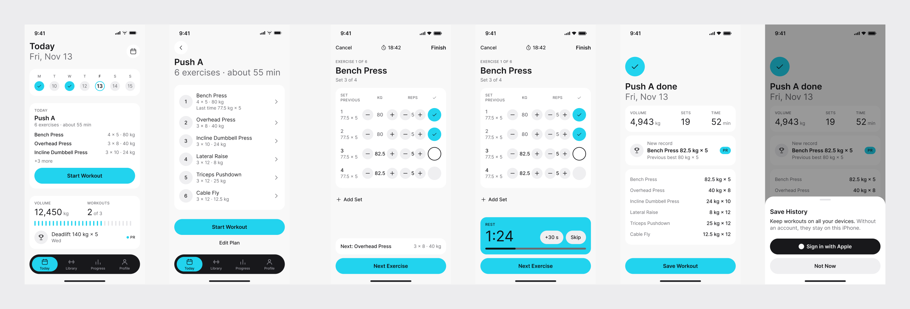
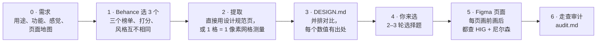
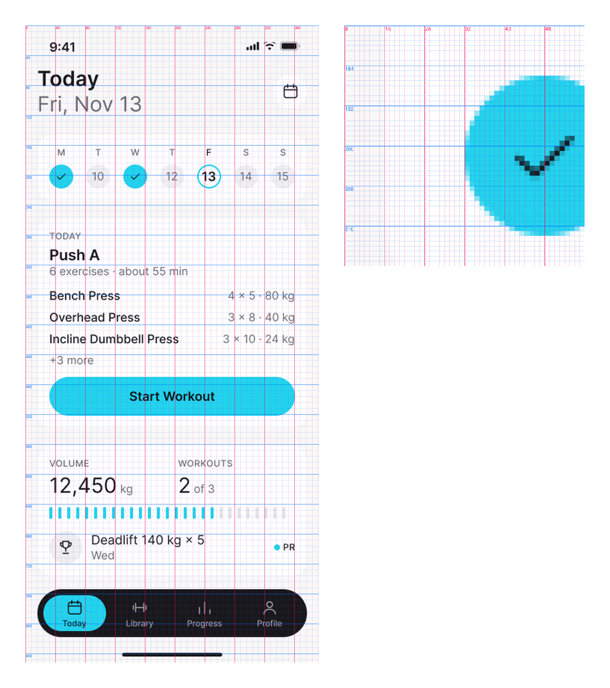
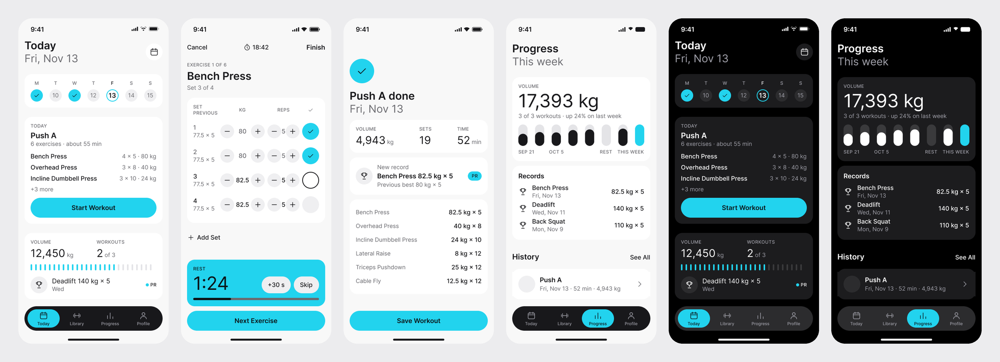
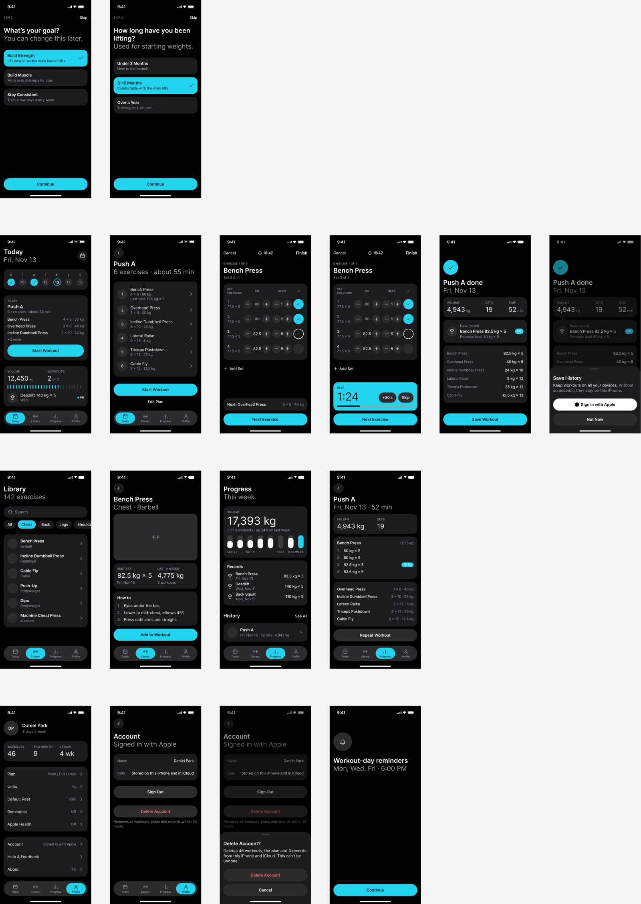

# AutoFigma-AppDesign

[English](README.md) | 简体中文

**参考 Behance 上的真实作品，在 Figma 里设计一整套 iOS App，而且没有"AI 味"。**

`figma-app-design-builder` 是一个 Claude Code 技能（Skill）。你说想做什么 App，它就去 Behance 挑出 3 个口碑好、风格各不相同的案例，逐像素测量；然后写一份每个数字都有出处的设计规范，用选择题让你决定风格，最后在 Figma 里画出所有页面。每个页面都要对照 Apple 人机界面指南（HIG）和尼尔森十大可用性原则检查。



## 目录

- [为什么做这个](#为什么做这个)
- [工作流程](#工作流程)
- [特点](#特点)
- [安装](#安装)
- [运行条件](#运行条件)
- [使用方法](#使用方法)
- [示例：一款力量训练 App](#示例一款力量训练-app)
- [仓库结构](#仓库结构)
- [免责声明](#免责声明)
- [许可证](#许可证)
- [致谢与出处](#致谢与出处)

## 为什么做这个

只对 AI 说一句"设计一个健身 App"，得到的往往是它训练数据的平均值：卡片套卡片、每个区块都有描边加阴影、紫蓝渐变、没有视觉焦点，再配上"释放你的潜能"之类的空话。这个技能反过来做：

1. **先向真实作品学习**：挑 3 个同类、受欢迎且风格明显不同的 App，精确测量。
2. **由人来决定**：每个风格决定都是一道选择题，选项全部来自这 3 个参考作品。
3. **按规则设计**：每个页面只用定稿规范里的数值来画，并对照 Apple HIG 和尼尔森原则检查。

## 工作流程



| 步骤 | 做什么 | 产出 |
|---|---|---|
| **0 · 需求** | 问清楚给谁用、必备功能、想要的感觉和范围；起草页面地图（所有页面、各属哪个 Tab、哪些是模态流程），和你确认。 | `00-brief.md` |
| **1 · 在 Behance 选 3 个作品** | 在 Behance 搜索，从 **Most Appreciated（最多点赞）**、**Most Viewed（最多浏览）**、**Most Discussed（最多讨论）** 三个榜单各取前 15 左右。先过滤掉不是 App、或正面平铺页面太少的作品，再按人气打分（点赞、浏览、评论、点赞率、上榜数）。然后对排名靠前的作品做视觉评审，选出风格标签明显不同的 3 个，这样后面的选择题才有真正的选项。 | `01-candidates.csv`、`01-candidates.md` |
| **2 · 提取** | 作品里有 **Design Style Guide（设计规范页）** 的，直接采用其中的数值（作者给的数比测量更准）。其余内容在网格上测量，**一格等于一个 @1x 设计像素（1 pt）**：边距、尺寸、间距、圆角、颜色。同时记录 UX：主流程、导航、状态反馈、何时要求登录。 | `research/<app>.md` |
| **3 · DESIGN.md** | 第一部分把 3 个作品按维度并排对比（布局、字体、颜色、圆角、卡片、按钮、Tab Bar……），每个单元格都有出处，违反 HIG 的做法会标出来。 | `DESIGN.md` 第一部分 |
| **4 · 你来选** | 2–3 轮、每轮 3–5 道选择题，先定全局（整体风格、屏幕尺寸、边距），再定组件细节。每个选项写明具体数值和出处；违反 HIG 的做法不列为选项；附带有依据的推荐。任何一题都可以回答"推荐"。 | `DESIGN.md` 第二、三部分 |
| **5 · Figma 页面** | 先建变量、文字样式和组件，再按页面地图逐页绘制，只使用 DESIGN.md 里的数值。每页画之前列出涉及的 HIG 和尼尔森规则，画完后过一遍检查清单并当场修正。3 个参考里都没有的页面（付费墙、空状态等），会从别的 Behance 作品借鉴结构，但绝不搬它的视觉。 | Figma 文件、`screens.md` |
| **6 · 走查审计** | 把每个主要任务从头走到尾，找单看一页发现不了的问题（流程太长、没有退路、用词不一致），按尼尔森 0–4 级严重程度评级，并对全 App 跑一遍 HIG 和"去 AI 味"清单。这是一份报告，改不改由你决定。 | `audit.md` |

技能会用你的语言和你交流、写 Markdown 文件。组件名、HIG 术语和单位保留英文（Tab Bar、Sheet、44 pt）。

## 特点

### 每个结论都有出处

为了防止 AI 编造数字，所有数值和设计判断，无论在对话里还是文件里，都带有来源标签：

| 标签 | 示例 |
|---|---|
| Behance 作品 | `[Behance · LGrow - Personal Coaching Fitness App · Tobi Bui & Design Team Ekotek · https://www.behance.net/gallery/254678997/… · image 07]` |
| 测量值 | `[Measured ≈ · research/nutripal/04_zoom_card.png · ±2 pt]` |
| 作者的设计规范 | `[Spec · NutriPal img 16]` |
| Apple HIG / 尼尔森 | `[HIG · Tab bars]`、`[Nielsen #5 Error prevention]` |
| 你的选择 | `[User choice · round 1 Q3]` |
| 没有外部来源 | `[AI suggestion]`，绝不当作事实陈述 |

Behance 上的数据只写真正在页面上读到的，读不到就写"未读取"。参考作品之间数值不一致时，分别列出各自的值和出处，不取平均。

### 三个辅助脚本

都是普通的 Python 3 脚本，位于 `skills/figma-app-design-builder/scripts/`。流程中由 Claude 调用，你也可以自己运行。

| 脚本 | 作用 | 示例 |
|---|---|---|
| `rank_candidates.py` | 给 Behance 候选池打分。第一轮只按人气排名（用池内百分位，结果可复现）；第二轮加入视觉评审（人气 40% + 视觉 60%，有设计规范页加 0.05），并选出 5 个风格标签中至少 2 个不同的 N 个作品。 | `python scripts/rank_candidates.py design/01-candidates.csv --final 3` |
| `grid_extract.py` | 1 格 = 1 像素测量。先把展示图里的手机屏幕缩放回设计宽度，然后：`info` 判断清晰度，`overview` 画带坐标的网格，`zoom` 放大局部、每格一条线，`edges` 沿某行或某列读出边距、尺寸和间距，`colors`/`sample` 读取颜色。需要 Pillow。 | `python scripts/grid_extract.py edges shot.png --crop 120,80,520,946 --row 250` |
| `contrast.py` | 按 HIG 阈值计算 WCAG 对比度（17 pt 及以下 4.5:1；18 pt 及以上或粗体 3:1），用来代替"看着应该够清楚"的猜测。 | `python scripts/contrast.py "#6B6B70" "#F8F8F8"` → `4.99:1 … PASS` |



### "去 AI 味"清单

[`references/anti-ai-checklist.md`](skills/figma-app-design-builder/references/anti-ai-checklist.md) 把常见症状分成四组，并写明口碑好的真实设计是怎么做的。设计时当作约束，审查时当作清单：

- **视觉**：最多两层（背景 + 卡片），靠填充色分层而不是描边和阴影；强调色只用于状态和主操作；一个胶囊圆角加一个卡片圆角；一套图标；不用 emoji 当图标；不加光晕。
- **结构**：每页一个主角；组内间距约为组间间距的一半；用底部 Sheet 而不是居中弹窗卡片；不为不存在的数据画占位卡片。
- **文案**：字越少越好，依据苹果 HIG 的 Writing 规范："Check each word to be sure it needs to be there. If you can use fewer words, do so."（逐字检查是否必要，能少用词就少用。）不写重复屏幕上已有内容的说明，不说"我们"，少用"你的"。按钮是"动词 + 对象"（"开始训练"），错误提示要说明怎么改，一个概念只用一个词。
- **数据**：真实感的名字和价格，合计等于各项之和，各页面数字一致。

清单最后有七个自查问题，比如"遮住 Logo，还认得出这是哪个 App 吗？"

## 安装

三种方式任选其一，装完后重启 Claude Code。

### 1. Claude Code 插件

```
/plugin marketplace add ws0325/AutoFigma-AppDesign
/plugin install figma-app-design-builder@autofigma-appdesign
```

### 2. `npx skills`

```bash
npx skills add ws0325/AutoFigma-AppDesign
```

### 3. 一行命令安装

macOS / Linux：

```bash
curl -fsSL https://raw.githubusercontent.com/ws0325/AutoFigma-AppDesign/main/install.sh | bash
```

Windows PowerShell：

```powershell
irm https://raw.githubusercontent.com/ws0325/AutoFigma-AppDesign/main/install.ps1 | iex
```

安装脚本会把技能复制到 `~/.claude/skills/figma-app-design-builder`（覆盖旧版本），并为网格脚本安装 Pillow。如果想装到当前项目的 `./.claude/skills`：

```bash
curl -fsSL https://raw.githubusercontent.com/ws0325/AutoFigma-AppDesign/main/install.sh | SKILL_SCOPE=project bash
```

```powershell
$env:SKILL_SCOPE = "project"; irm https://raw.githubusercontent.com/ws0325/AutoFigma-AppDesign/main/install.ps1 | iex
```

如果已经克隆了仓库，运行 `bash install.sh` 或 `powershell -ExecutionPolicy Bypass -File install.ps1` 即可。卸载时删除技能目录下的 `figma-app-design-builder` 文件夹。

## 运行条件

| 条件 | 用途 |
|---|---|
| **Claude Code**，或其他能加载 Agent Skills 的客户端 | 运行技能。 |
| **通过 Figma MCP 服务器连接的 Figma** | 把页面写入 Figma。没有连接时，技能会提示你连接 Figma，在此之前先输出 HTML 页面（`design/screens.html`）。 |
| **浏览器工具**（例如 Claude in Chrome） | Behance 页面靠 JavaScript 渲染，直接抓取网页会返回 HTTP 403。没有浏览器时，技能会请你提供链接或截图。 |
| **Python 3 + Pillow** | 运行脚本。只有 `grid_extract.py` 需要 Pillow（`pip install pillow`）。如果 pip 拒绝往系统自带的 Python 里安装，请使用虚拟环境。 |

## 使用方法

直接描述你想做的 App 就行，例如：

```
帮我做一款记账 App
```
```
Design me a habit-tracking app.
```
```
我想做一个预约攀岩馆场次的 iPhone App，深色模式最重要。
```
```
帮我找冥想类 App 的 Behance 参考，写一份 DESIGN.md，先不要画页面。
```

会在什么时候问你什么：

1. **一开始**：一条消息问清需求（用途、必备功能、想要的感觉、范围），然后请你确认页面地图。
2. **调研结束后**：简短汇报选中的 3 个作品，附链接和一句话风格描述。这里不提问，直接继续。
3. **风格决定**：2–3 轮、每轮 3–5 道选择题。可以这样回答：`1A 2C 3 推荐`，或者`剩下的都按推荐`。
4. **开始画之前**：给你看定稿规则和速查表，确认后开画。
5. **最后**：审计报告。你说改才改。

所有产出都放在被设计 App 的项目里的 `design/` 文件夹（也可以指定别的位置）：

```
design/
├── 00-brief.md          需求和页面地图
├── 01-candidates.csv    Behance 候选池（脚本输入）
├── 01-candidates.md     打分结果和选中的 3 个
├── research/<app>/      参考截图和网格图（仅存本地）
├── research/<app>.md    单个作品的完整提取
├── DESIGN.md            设计规范：对比 + 你的选择 + 定稿规则
├── screens.md           页面清单、Figma 链接、逐页检查
└── audit.md             走查审计报告
```

如果那个项目是 git 仓库，请把 `design/research/*/` 加进 `.gitignore`，确保下载的参考图片不会被提交。

## 示例：一款力量训练 App

[`examples/fitness-app/design/`](examples/fitness-app/design/) 是为演示用的力量训练记录 App **Repwise** 完整跑的一遍（示例文件为英文）。

**需求**（[`00-brief.md`](examples/fitness-app/design/00-brief.md)）：面向 20–35 岁、每周去健身房三次左右、总记不清上次练了多重的人。最常做的事：开始今天的训练、配合休息计时器快速记录每组、查看进步。感觉：冷静、专注，不要荧光色，不要游戏化。只在第一次保存训练时才请求"通过 Apple 登录"。

**选作品**（[`01-candidates.md`](examples/fitness-app/design/01-candidates.md)）：搜索 `fitness app`，合并去重后 32 个候选；硬性条件排除 5 个（其中一个是逐张看完 13 张图后才发现几乎全是倾斜或手持的展示图）；逐图评审 16 个。人气前 8 名只覆盖两种风格，所以第 9–16 名也评审了。

| | 作品 | 作者 | 风格 |
|---|---|---|---|
| A | [Fitness mobile app \| UX/UI design](https://www.behance.net/gallery/243053067/Fitness-mobile-app-UXUI-design) | Oksana Bashkatova，与 ШКОЛА ДИЗАЙНА | 浅灰底 + 白卡片，青柠绿和薰衣草紫点缀，真人照片 |
| B | [LGrow - Personal Coaching Fitness App \| UX/UI](https://www.behance.net/gallery/254678997/LGrow-Personal-Coaching-Fitness-App-UXUI) | Tobi Bui & Design Team Ekotek | 纯黑底，白色主按钮，蓝色光晕，点阵数字 |
| C | [AI Habit & Fitness Tracker Mobile App \| UI UX Design](https://www.behance.net/gallery/250740123/AI-Habit-Fitness-Tracker-Mobile-App-UI-UX-Design) | Sriraj Mohan | 米白底，黑白单色，只有图表用颜色 |

**提取**（[`research/`](examples/fitness-app/design/research/)）：A 和 C 有完整的设计规范页，数值直接采用；B 的尺寸靠测量（±1.2 pt）。检查中标出了不采纳的做法：对比度只有 2.3–2.6:1 的灰色次要文字（A、C）、Light 字重（C）、只有图标没有文字的 Tab（C）、一打开就要求登录（B）、装饰性光晕（B）。

**部分选择结果**（[`DESIGN.md`](examples/fitness-app/design/DESIGN.md) 第二部分）：

| 问题 | 选择 | 结果 |
|---|---|---|
| 整体风格 | C | 米白底，单色界面，颜色只用于数据 |
| 左右边距 | A | 16 pt（来自 Femotion 设计规范，A、C 的测量也印证） |
| 背景层次 | A | `#F8F8F8` 底 + `#FFFFFF` 卡片，无阴影 |
| 强调色 | 先按推荐，后改 | 起初用近黑 `#18181B`；看过成品后用户希望更鲜艳，改为青色 `#22D3EE`，用于操作和每屏一处数据重点，青色上的文字用近黑（白字只有 1.81:1，不达标） |
| 字体 | 推荐 | Inter（C 用的 Lufga 是付费字体） |
| 卡片圆角 | 推荐 | 20（在 C 上测得） |

用户在第一轮之后说"直接出一版"，所以第二、三轮都采用了推荐选项。这些规则都打了标签并记入决策记录，之后可以重新讨论。次要文字用 `#6B6B70`，在底色上对比度 4.99:1（用 `contrast.py` 算出），替代了参考作品里不达标的灰色。

**屏幕**（[`screens.md`](examples/fitness-app/design/screens.md)，[Figma 文件](https://www.figma.com/design/4OA6e0F7zsToQrgMqzkW6Z)）。共 18 屏高保真：引导、Today、完整训练流程（预览、记录、休息计时、总结、登录弹窗）、动作库、进度、个人页、删除账号、提醒权限说明页，以及休息计时在锁屏 Live Activity 和灵动岛上的样子。先建好变量、文字样式和组件，再由 4 个子代理按同一份说明并行画各个流程，所以每屏的示例数据都一致。每个 App 屏幕还有一份深色版，靠切换变量模式生成。



**走查**（[`audit.md`](examples/fitness-app/design/audit.md)）。按 4 个主要任务走完整流程，修了 8 处问题，包括：按 HIG"能用更少的词就用更少的词"删减啰嗦文案；"Save Workout"旁边重复的"Done"；权限说明页上的返回按钮；一个在深色模式下变白的组件底色；深色 Tab 文字对比度从 3.26:1 提到 5.30:1。另有 8 个较小的待办列在报告里（例如 Sign in with Apple 官方素材、动作示范图）。



完整规范（字号体系、浅色和深色的颜色变量、组件、页面模式、尼尔森原则的具体落实、逐页检查清单）见 [`examples/fitness-app/design/DESIGN.md`](examples/fitness-app/design/DESIGN.md)。

## 仓库结构

```
AutoFigma-AppDesign/
├── .claude-plugin/
│   ├── plugin.json               插件清单（figma-app-design-builder）
│   └── marketplace.json          插件市场清单（autofigma-appdesign）
├── skills/
│   └── figma-app-design-builder/
│       ├── SKILL.md              Claude 遵循的工作流程
│       ├── references/
│       │   ├── behance-research.md     搜索、打分、视觉评审、网格提取
│       │   ├── user-choices.md         选择题格式和题目清单
│       │   ├── design-spec-template.md DESIGN.md 的结构
│       │   ├── apple-hig-rules.md      带具体数值的 HIG 规则和检查清单
│       │   ├── nielsen-heuristics.md   十大原则、严重程度、走查表
│       │   ├── anti-ai-checklist.md    AI 味的症状和替代做法
│       │   └── figma-build.md          Figma 搭建顺序、命名、HTML 备选方案
│       ├── assets/
│       │   └── example-design-rules.md 一份完整的定稿规范，用来参考详细程度
│       └── scripts/
│           ├── rank_candidates.py
│           ├── grid_extract.py
│           └── contrast.py
├── examples/
│   └── fitness-app/design/       演示运行（需求、候选、调研、DESIGN.md、screens.md、audit.md）
├── docs/images/                  README 截图
├── install.sh                    macOS / Linux 安装脚本
├── install.ps1                   Windows 安装脚本
├── README.md
└── README.zh-CN.md
```

## 免责声明

- 本项目是独立项目，与 Apple、Adobe 或 Behance、Figma、Nielsen Norman Group **均无关联，也未获得其认可**。所有产品名称和商标归各自所有者。
- **Behance 上的作品归原作者所有。** 本技能只研究其中的布局模式和可测量的数值（尺寸、间距、颜色、流程），生成的设计中绝不使用它们的图片、品牌、插画或文案。
- 运行时下载的参考图片只保存在你的电脑上用于分析。本仓库通过 `.gitignore` 排除了这些图片，从不提交。在你自己的项目里也请这样做。
- 使用 Behance 时请遵守其使用条款（[Adobe 通用使用条款](https://www.adobe.com/legal/terms.html)）。分享受这些作品启发的成果时，请注明原作者。
- 测量值来自展示图而非源文件，只是近似值（每个作品的测量精度记录在各自的提取文件里）。
- `references/apple-hig-rules.md` 中的 HIG 摘要核对于 2026 年 11 月。Apple 会更新指南，依赖某个数值之前请到[官方 HIG](https://developer.apple.com/design/human-interface-guidelines/) 确认。
- 生成的设计只是起点，不是成品。上线前需要人工审查，包括无障碍、法律和品牌方面的审查。

## 许可证

许可证尚未确定，将由作者后续添加。在此之前，除 GitHub 服务条款允许的范围（在 GitHub 上查看和 Fork）外，不授予其他许可。如果你想使用或改编本项目，请提交 Issue。

## 致谢与出处

- **Apple 人机界面指南（Human Interface Guidelines）**：<https://developer.apple.com/design/human-interface-guidelines/>。技能中使用的是我们用自己的话写的摘要。
- **Jakob Nielsen，10 Usability Heuristics for User Interface Design**（1994），Nielsen Norman Group：<https://www.nngroup.com/articles/ten-usability-heuristics/>；以及[严重程度评级](https://www.nngroup.com/articles/how-to-rate-the-severity-of-usability-problems/)。
- **WCAG 2.x 对比度公式**，W3C：<https://www.w3.org/TR/WCAG21/#contrast-minimum>。
- **示例中研究的参考作品**（均发布在 Behance，感谢各位作者）：
  - [Fitness mobile app | UX/UI design](https://www.behance.net/gallery/243053067/Fitness-mobile-app-UXUI-design)：Oksana Bashkatova（Оксана Башкатова），与 ШКОЛА ДИЗАЙНА
  - [LGrow - Personal Coaching Fitness App | UX/UI](https://www.behance.net/gallery/254678997/LGrow-Personal-Coaching-Fitness-App-UXUI)：Tobi Bui & Design Team Ekotek
  - [AI Habit & Fitness Tracker Mobile App | UI UX Design](https://www.behance.net/gallery/250740123/AI-Habit-Fitness-Tracker-Mobile-App-UI-UX-Design)：Sriraj Mohan
  - [Home workout app for fitness](https://www.behance.net/gallery/251510807/Home-workout-app-for-fitness)：SK RADWOAN、Farhan、Sheikh Raihan、Md Naimur Rahman & Circle Team（仅借鉴了引导页的选项列表结构）
